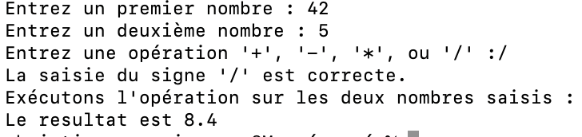

# minicalculator_python

Petit programme en ligne de commande qui effectue une opération de base (+, -, *, /) entre deux nombres entiers.
Projet réalisé dans le cadre de mon apprentissage de Python sur Openclassroom (cours : apprenez les bases Python).

Fonctionnalités
- Saisie de deux nombres entiers par l'utilisateur
- Choix de l'opération : +, -, * ou /
- Vérification des saisies (nombres valides, opération reconnue)
- Gestion de la division par zéro

Ce que j'ai appris
- Lire des saisies avec input() et les convertir avec int()
- Valider des données avec isnumeric()
- Utiliser les structures conditionnelles if / elif / else
- Formater l'affichage avec les f-strings
- Arrêter proprement un programme avec SystemExit
- Découvrir la structure match / case

Limites actuelles et pistes d'amélioration
- Seuls les entiers positifs sont acceptés (pas de nombres négatifs ni décimaux)
- Le programme s'arrête après un calcul, sans boucle pour en enchaîner plusieurs

Autrice
@ChristianeLearningPython
